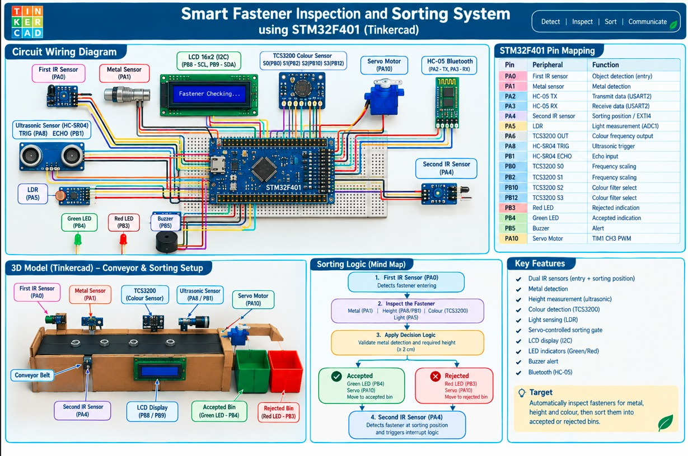
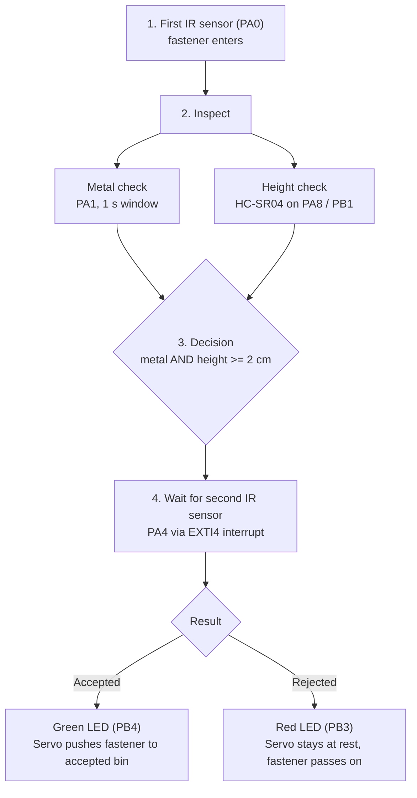
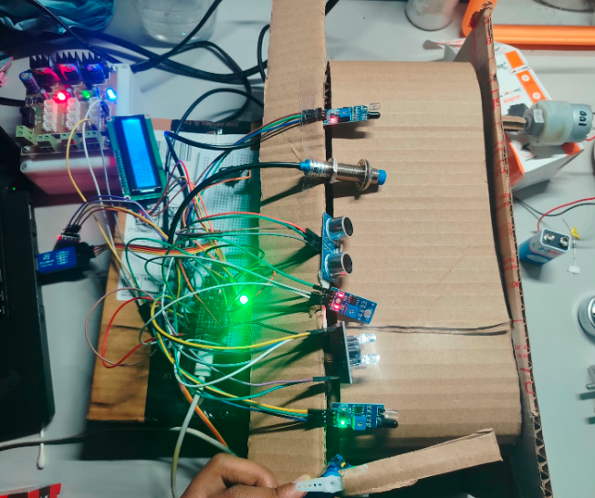

<div align="center">

# ⚙️ Smart Fastener Inspection and Sorting System

**An STM32F401 embedded system that inspects fasteners on a conveyor belt for metal and height, then sorts them into accepted and rejected bins, with live Bluetooth monitoring and a Python machine-learning dashboard.**




</div>

---

## 📖 Overview

Manual inspection of fasteners (nuts, washers, bolts) is slow and error-prone. This project automates it with a small conveyor rig built around an **STM32F401** microcontroller.

As each fastener moves along the belt it is detected, checked for **metal content** and **height**, and then pushed into the correct bin by a servo-controlled gate. Every step is shown on a 16x2 LCD, signalled with LEDs and a buzzer, and streamed over **Bluetooth (HC-05)** to a **Python desktop dashboard** that logs data, plots live graphs and can train a decision-tree model.

The firmware is written at **register level** (CMSIS only, no HAL), so every peripheral is configured directly.

## ✨ Features

| Area | What it does |
|---|---|
| **Object detection** | Entry IR sensor (PA0) counts every new fastener. A second IR sensor (PA4) raises an **EXTI4 interrupt** at the sorting position. |
| **Metal detection** | Proximity sensor (PA1) sampled over a 1 second window per object. |
| **Height measurement** | HC-SR04 ultrasonic sensor timed with a 1 MHz hardware timer; height = belt distance minus measured distance. |
| **Colour sensing** | TCS3200 read through red, green and blue filters, gated by an LDR light check (ADC1). |
| **Sorting** | Servo gate on TIM1 PWM pushes accepted fasteners into the accepted bin. |
| **Feedback** | 16x2 I2C LCD, green and red LEDs, buzzer alert. |
| **Wireless monitoring** | Live status and per-object results over HC-05 (USART2, 9600 baud). |
| **PC dashboard** | Python GUI with live readings, graphs, statistics, CSV logging, decision-tree training and C code export. |

## 🔄 How It Works



**Acceptance rule:** a fastener is **accepted** only when metal is detected **and** the height is at least `MIN_HEIGHT_CM` (2 cm). An invalid ultrasonic reading or any failed check results in **rejected**.

Between objects the firmware runs a continuous **live loop** that refreshes distance, height, LDR level and (when the LDR reports enough light) the TCS3200 red, green and blue counts, then sends a status report over Bluetooth.

## 📸 Hardware

<div align="center">


*Working prototype: sensors mounted along the conveyor, STM32 board and breadboard wiring on the left, LCD and indicators powered up.*
</div>

## 🔌 Pin Mapping

| Pin | Peripheral | Function |
|---|---|---|
| PA0 | First IR sensor | Object detection (entry), active LOW |
| PA1 | Metal sensor | Metal detection |
| PA2 | HC-05 TX | USART2 transmit |
| PA3 | HC-05 RX | USART2 receive |
| PA4 | Second IR sensor | Sorting position, EXTI4 falling edge |
| PA5 | LDR | Light measurement, ADC1 channel 5 |
| PA6 | TCS3200 OUT | Colour frequency output |
| PA8 | HC-SR04 TRIG | Ultrasonic trigger |
| PA10 | Servo motor | TIM1 CH3 PWM |
| PB0 | TCS3200 S0 | Frequency scaling |
| PB1 | HC-SR04 ECHO | Echo input |
| PB2 | TCS3200 S1 | Frequency scaling |
| PB3 | Red LED | Rejected indication |
| PB4 | Green LED | Accepted indication |
| PB5 | Buzzer | Alert |
| PB8 | LCD SCL | I2C1 clock |
| PB9 | LCD SDA | I2C1 data |
| PB10 | TCS3200 S2 | Colour filter select |
| PB12 | TCS3200 S3 | Colour filter select |

## 🗂️ Repository Structure

```
smart-fastener-sorting-system/
├── firmware/
│   └── main.c                    # STM32F401 register-level firmware
├── software/
│   ├── fastener_sorting_gui.py   # Python desktop dashboard
│   └── requirements.txt          # Python dependencies
├── docs/
│   └── images/
│       ├── system-overview.png   # Wiring, pin map, conveyor model, logic
│       └── hardware-setup.png    # Photo of the real prototype
├── .gitignore
├── LICENSE
└── README.md
```

## 🚀 Getting Started

### Firmware

1. Create an STM32F401 project in your IDE (Keil µVision, STM32CubeIDE or similar) using the CMSIS device headers (`stm32f4xx.h`).
2. Add `firmware/main.c` to the project.
3. Build and flash to the board.

Clock assumption: the code expects the default **16 MHz HSI** clock. The TIM2 microsecond timer, USART2 baud rate (`BRR = 0x0683` gives 9600 baud), I2C timing and TIM1 servo PWM are all derived from it.

Main settings are at the top of `main.c`:

| Setting | Default | Meaning |
|---|---|---|
| `MIN_HEIGHT_CM` | 2 | Minimum height for acceptance |
| `BELT_DISTANCE_CM` | 20 | Sensor-to-belt distance used to compute height |
| `METAL_CHECK_TIME_MS` | 1000 | Metal sampling window per object |
| `PUSH_TIME_MS` | 1000 | How long the servo holds the push position |
| `LDR_MIN_ADC` | 2000 | Minimum light level before colour is read |
| `LCD_ADDR` | 0x27 | I2C address of the LCD backpack |

### Python dashboard

```bash
pip install -r software/requirements.txt
python software/fastener_sorting_gui.py
```

1. Pair the **HC-05** with your PC (default PIN is usually `1234` or `0000`).
2. Select the HC-05 **outgoing** COM port, keep the baud rate at **9600**, and press **Connect**.
3. Use **Start Collection** to log objects to a CSV dataset.
4. Use **Train Model** to fit a decision tree, and **Export to C Code** to generate `fastener_model.h` / `.c` for the firmware.

The camera panel is optional (`pip install opencv-python`).

## 🧠 Machine Learning

The dashboard logs `Metal`, `Height`, `Red`, `Green`, `Blue` and the STM32's accept or reject label. From that dataset it can:

- train a **decision tree** (depth limited to 5) with a stratified train/test split,
- report accuracy, confusion matrix, feature importance and the tree rules,
- compare the model's prediction with the STM32 decision on live objects,
- export the trained tree as plain C (`fastener_predict(...)`) that can run on the microcontroller without any library.

## 🛠️ Technologies

`STM32F401` · `Embedded C` · `CMSIS register-level programming` · `GPIO` · `EXTI interrupts` · `ADC` · `TIM (PWM, microsecond timing)` · `USART` · `I2C` · `HC-05 Bluetooth` · `Python` · `Tkinter` · `scikit-learn` · `matplotlib`

## 🗺️ Roadmap

- [ ] Use the colour reading in the accept/reject decision
- [ ] Run the exported decision tree on the STM32
- [ ] Add a second servo position for an active rejected-bin gate (`REJECTED_ANGLE` is already defined)
- [ ] Add a demo video

## 📄 License

Released under the [MIT License](LICENSE).
## 🙋 Author

**Natti Vishnu Neha** · [GitHub](https://github.com/VishnuNeha) · [LinkedIn](https://linkedin.com/in/natti-vishnu-neha/)

If this helped you, please ⭐ the repo!

